# دارایی‌های گرافیکی MES / MES GitHub Assets

این پوشه مجموعه‌ای از تصاویر، فایل‌های SVG و عناصر گرافیکی مورد استفاده در مستندات **معمار الکترونیک صنعت / MEMAR ELECTRONIC SANAT (MES)** را نگهداری می‌کند. این دارایی‌ها برای ایجاد ساختار بصری یکپارچه در READMEها، راهنماها و مستندات فنی استفاده می‌شوند.

This directory contains SVG artwork and visual elements used throughout **MEMAR ELECTRONIC SANAT (MES)** documentation. These assets help maintain a consistent visual identity across repository README files, application notes, and technical guides.

## بنر معرفی / Hero Banner

بنر معرفی برای نمایش هویت مجموعه در ابتدای صفحات و مستندات.  
Use this banner to introduce MES at the beginning of documentation pages.

## سربرگ بخش / Section Header

برای تفکیک بصری بخش‌های اصلی و عنوان‌گذاری در مستندات.  
Use this graphic to visually distinguish major sections and headings.

## کارت پروژه / Project Card

قالب گرافیکی مناسب برای معرفی پروژه‌ها، ابزارها و مخازن.  
A visual card template for presenting projects, tools, and repositories.

## نوار وضعیت / Status Strip

برای نمایش وضعیت انتشار، نسخه، تکمیل ترجمه یا هشدارهای مستندات.  
Use this strip to communicate release status, version, translation progress, or documentation notices.

## تصویر پایانی / Thank-You Footer

برای پایان‌بندی صفحات و مستندات با هویت بصری MES.  
Use this graphic as a branded closing element in documentation.

## فهرست فایل‌ها / Asset Files

| فایل / File | کاربرد / Purpose |
|---|---|
| [MES-Divider.svg](MES-Divider.svg) | جداکننده بخش‌ها / Section divider |
| [MES-Hero-Banner.svg](MES-Hero-Banner.svg) | بنر معرفی / Hero banner |
| [MES-Project-Card.svg](MES-Project-Card.svg) | کارت معرفی پروژه / Project card |
| [MES-Section-Header.svg](MES-Section-Header.svg) | سربرگ بخش / Section header |
| [MES-Status-Strip.svg](MES-Status-Strip.svg) | نوار وضعیت / Status strip |
| [MES-Thank-You-Footer.svg](MES-Thank-You-Footer.svg) | تصویر پایانی / Closing graphic |

## نحوه استفاده / Usage

در فایل‌های Markdown از مسیر نسبی استفاده کنید و عمق پوشه README را در محاسبه مسیر در نظر بگیرید. برای نمایش SVG می‌توان از دستور Markdown تصویر استفاده کرد.

Use relative paths in Markdown and account for the README file's directory depth. SVG files can be embedded with standard Markdown image syntax.

## تصاویر و دیاگرام‌های راهنما / Images and Diagrams

تمام فایل‌های گرافیکی این پوشه برای استفاده در READMEها و راهنماهای فنی در دسترس هستند.  
All graphics in this directory are available for use in repository README files and technical guides.

## تهیه و تدوین / Credits

**معمار الکترونیک صنعت**  
**MEMAR ELECTRONIC SANAT (MES)**

همراه شما در مسیر طراحی و ساخت مدارهای مطمئن  
*Your partner in designing and building reliable circuits.*

- Telegram: https://t.me/Memar_Electronic
- Instagram: https://www.instagram.com/Memar.Electronic
- GitHub: https://github.com/MEMAR-ELECTRONIC-SANAT

  

